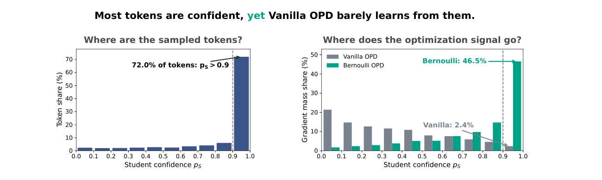
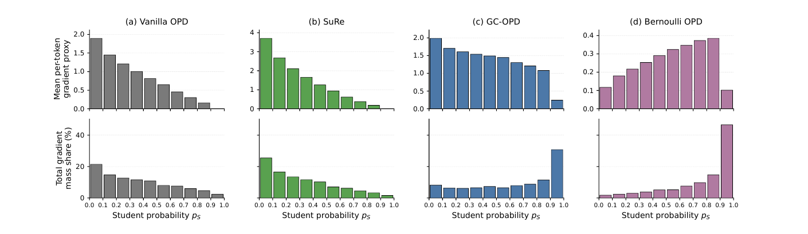

# Bernoulli On-Policy Distillation

Official research code for **“Bernoulli On-Policy Distillation: Don’t Ignore High-Confidence Student Tokens.”**

Mingyu Cao<sup>1</sup>, Yaokai Jin<sup>2</sup>, Shiwei Liu<sup>3,4,5</sup>, Lu Yin<sup>1</sup>  
<sup>1</sup>University of Surrey · <sup>2</sup>University College London · <sup>3</sup>ELLIS Institute Tübingen · <sup>4</sup>Max Planck Institute for Intelligent Systems · <sup>5</sup>Tübingen AI Center  
Correspondence: [Lu Yin](mailto:l.yin@surrey.ac.uk)



Vanilla sampled reverse-KL OPD assigns the sampled token a gradient proportional to
`(log p_T - log p_S)(1 - p_S)`. The softmax factor suppresses learning on confident student
tokens. Bernoulli OPD instead uses binary cross-entropy on the sampled-token event, producing
the direct probability-gap signal `p_S - p_T`.



## What is included

- The Slime-based Bernoulli OPD, Balanced Bernoulli, GC-OPD, PowerOPD, SuRe, and Vanilla OPD implementations.
- Reproducible launch configurations for all four teacher–student settings.
- One training entry point and one evaluation entry point.
- AIME24 Avg@8 checkpoint selection by default.
- Final evaluation defaults matching the experiments: maximum length 32168 and @32 for competition benchmarks, except Qwen3-8B-DAPO-RL (38912 and @16); MATH500 is always @4.
- CPU-level objective and integration tests in `tests/`.

The repository contains no model weights, datasets, training logs, or generated responses.

## Experimental settings

| Setting ID | Student | Teacher | Thinking | Final max length | Competition samples |
|---|---|---|---:|---:|---:|
| `qwen3_4b` | Qwen3-1.7B | Qwen3-4B-Instruct-2507 | off | 32168 | 32 |
| `qwen3_8b_rl` | Qwen3-1.7B | Qwen3-8B-DAPO-RL | off | 38912 | 32 |
| `deepseek_7b` | DeepSeek-R1-Distill-Qwen-1.5B | DeepSeek-R1-Distill-Qwen-7B | native | 32168 | 32 |
| `skywork_7b` | DeepSeek-R1-Distill-Qwen-1.5B | Skywork-OR1-Math-7B | native | 32168 | 32 |

Available method IDs are `vanilla`, `sure`, `poweropd`, `gc`, `bernoulli`, and
`balanced_bernoulli`. PowerOPD uses `alpha=5`.

## Installation

This code was tested on one node with four NVIDIA GH200 GPUs: two GPUs for actor training and
two for rollout generation plus teacher inference. Python dependencies are intentionally split:

1. Install the platform-specific compiled stack described in [`docs/ENVIRONMENT.md`](docs/ENVIRONMENT.md).
2. Install the small Python dependency set:

```bash
python -m pip install -r requirements.txt
python -m pip install -e . --no-deps
```

Slime loads Megatron-LM and SGLang from source. Set these paths before launching:

```bash
export MEGATRON_DIR=/path/to/Megatron-LM
export SGLANG_DIR=/path/to/sglang
export MODEL_ROOT=/path/to/models
export DATA_ROOT=/path/to/data
```

If the Conda environment is already active, set `SKIP_CONDA_ACTIVATE=1`. Otherwise the scripts
use `CONDA_ENV_NAME=opsa-slime` and `CONDA_SH=$HOME/miniconda3/etc/profile.d/conda.sh`.

## Models and data

Download and convert the student models to Megatron distributed checkpoints using Slime's
standard conversion workflow. The default local layout is:

```text
models/
├── Qwen3-1.7B/
├── Qwen3-1.7B_torch_dist/
├── Qwen3-4B-Instruct-2507/
├── Qwen3-8B-DAPO-iter449-disable-thinking/
├── DeepSeek-R1-Distill-Qwen-1.5B/
├── DeepSeek-R1-Distill-Qwen-1.5B_torch_dist/
├── DeepSeek-R1-Distill-Qwen-7B/
└── Skywork-OR1-Math-7B/
```

Public model identifiers are listed in each file under `configs/settings/`.
Prepare DAPO-Math-17K and the evaluation datasets as JSONL files with
`prompt` and `label` fields:

```bash
# Download all datasets using pinned revisions.
./scripts/download_data.sh

# Optional: specify a custom data directory.
./scripts/download_data.sh /path/to/data
```

The script produces the following directory structure:

```text
data/
├── dapo-math-17k/dapo-math-17k.jsonl
├── aime-2024/aime-2024.jsonl
├── aime-2025/aime-2025.jsonl
├── hmmt-feb-2025/hmmt-feb-2025.jsonl
├── amc-2023/amc-2023.jsonl
└── math-500/math-500.jsonl
```

Paths can be overridden with `PROMPT_DATA`, `AIME24_DATA`, `AIME25_DATA`,
`HMMT25_DATA`, `AMC23_DATA`, and `MATH500_DATA`.

For reproducibility, the downloader uses pinned Hugging Face revisions,
validates the expected number of examples, and writes a `source.json` file
next to each generated JSONL file.

## Training

Run one method in one setting:

```bash
./scripts/train.sh qwen3_4b bernoulli
./scripts/train.sh qwen3_8b_rl poweropd
./scripts/train.sh deepseek_7b gc
./scripts/train.sh skywork_7b balanced_bernoulli
```

Equivalent setting-specific launchers are under `scripts/settings/`, for example
`./scripts/settings/run-qwen3-4b.sh bernoulli`. These four small launchers make each paper
setting explicit while sharing the same audited training implementation.

The unified defaults are 200 optimizer updates, one response per prompt, training length 12000,
temperature 1.0, global batch size 64, Adam, constant `1e-6` learning rate, no warmup, and
gradient clipping at 1.0. AIME24 Avg@8 validation runs every 20 updates. Checkpoints omit
optimizer state and the retention helper keeps the best validation checkpoint and the last one.

Override a value with an environment variable, for example:

```bash
NUM_ROLLOUT=300 SEED=2026 ./scripts/train.sh qwen3_4b bernoulli
```

Run all six methods sequentially:

```bash
./scripts/train_all_methods.sh qwen3_4b
```


## Evaluation

Validation evaluates AIME24 with Avg@8:

```bash
./scripts/evaluate.sh qwen3_4b /path/to/checkpoint/root <CHECKPOINT_STEP> validation
```

Final evaluation runs AIME24, AIME25, HMMT25, and AMC23 with the setting-specific sample count,
then MATH500 with four samples:

```bash
./scripts/evaluate.sh qwen3_4b /path/to/checkpoint/root <BEST_CHECKPOINT_STEP> final
```


## Acknowledgements and license

The implementation is built on [Slime](https://github.com/THUDM/slime), Megatron-LM, and
SGLang. See [`docs/UPSTREAM_SLIME_README.md`](docs/UPSTREAM_SLIME_README.md) for upstream Slime
documentation. The code is released under the Apache License 2.0; paper figures remain subject
to the authors' paper copyright.

## Citation

```bibtex
@article{cao2026bernoulli,
  title   = {Bernoulli On-Policy Distillation: Don't Ignore High-Confidence Student Tokens},
  author  = {Cao, Mingyu and Jin, Yaokai and Liu, Shiwei and Yin, Lu},
  year    = {2026},
  note    = {Preprint}
}
```
